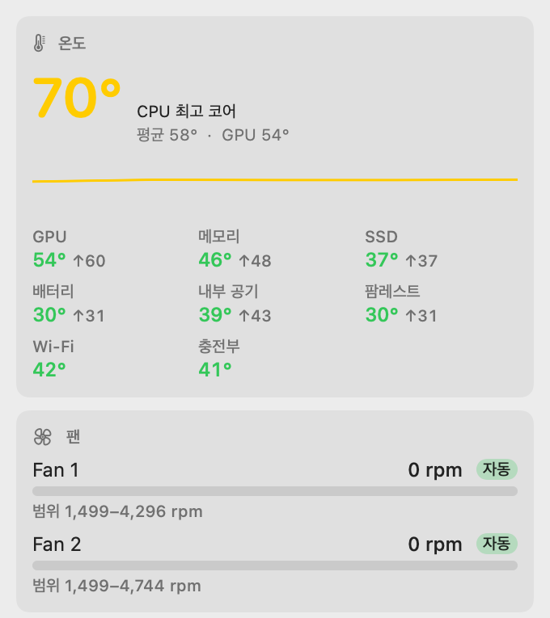
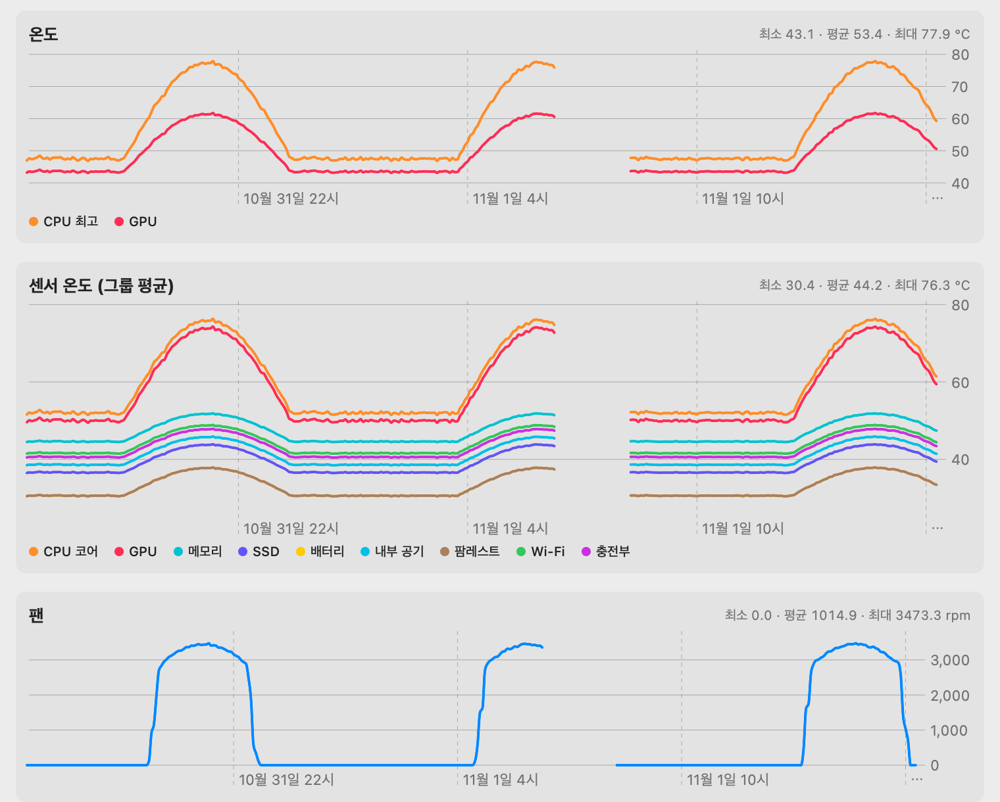

# MacPit

[English](README.md) · **한국어**

Apple Silicon Mac용 메뉴바 시스템 모니터 + **팬 제어** + **개발자 캐시 정리** 도구.
온도·팬·히스토리·캐시 정리를 하나의 오픈소스 앱으로.

> A menu bar system monitor for Apple Silicon Macs — CPU/GPU/sensor temperatures, manual & automatic fan control (target-temperature PI loop), metric history, and one-click cleanup of developer caches (npm, Gradle, JetBrains, Docker …).

<p>
  
  
</p>

<sub>오른쪽 히스토리 이미지는 렌더링 확인용 예시 데이터.</sub>

## 기능

### 🌡 온도 모니터링
- CPU 최고 코어 온도를 메뉴바에 표시. 표시 항목은 패널 하단 **메뉴바** 메뉴에서 선택: CPU% · 온도 · 메모리% · GPU 온도 · 팬 RPM · 네트워크 (기본 `17% 67° M74% 3.2k`)
- 센서 수십 개를 의미 단위로 묶어 **그룹별 평균·최고** 표시: CPU 코어 · GPU · 메모리 · SSD · 배터리 · 내부 공기 · 팜레스트 · Wi-Fi · 충전부
- 기기마다 실제로 읽히는 센서만 채택 → 없는 그룹은 자동으로 숨김

### 📊 시스템 · 프로세스
- CPU(user/sys) · 메모리 · 디스크 여유 · 네트워크 ↓/↑ · 부하 · 배터리
- **CPU·메모리 상위 프로세스 5개** — root 프로세스 포함 (패널이 열려 있을 때만 수집)

### 🌀 팬 제어
| 모드 | 동작 |
|---|---|
| 시스템 | macOS 에 맡김 (기본) |
| 수동 | 0~100% 고정 (0% = 최소 RPM) |
| 곡선 | 온도 → 팬% 선형 보간. 조용 / 균형 / 성능 프리셋 |
| 목표온도 | CPU 온도를 목표치 근처로 유지하는 PI 제어. 충분히 식으면 macOS 에 반납 |

**안전장치**
- 안전온도(기본 95°C) 이상이면 모드와 무관하게 100%
- 센서 읽기 실패 · 데몬 종료(SIGTERM 등) 시 즉시 macOS 에 반납
- 틱당 출력 변화 ±8% 제한 (급변 방지)
- 시작 시 이전 크래시로 남은 강제 모드 정리

**팬 개수 자동 대응**
- 팬리스(MacBook Air 등): 모니터링 전용, 제어 UI 숨김
- 1팬(Mac mini 등) / 2팬(MacBook Pro 등): 같은 % 를 팬별 최소~최대 RPM 으로 환산
- `FNum` 이 누락되거나 틀리게 보고돼도 팬 키를 직접 탐침해 교차 확인

### 🧹 스토리지 정리 (개발자 캐시 · Docker)
현재 차지하는 용량을 보여주고 원클릭으로 정리.

| 그룹 | 대상 |
|---|---|
| Node | npm · pnpm store · Yarn · Bun · node-gyp · Playwright/Puppeteer 브라우저 |
| JVM | Gradle caches/wrapper/daemon · Maven `~/.m2` ⚠︎ · JetBrains 캐시·로그 |
| Apple | Xcode DerivedData · iOS DeviceSupport · SwiftPM · CocoaPods |
| 기타 | pip · uv · Go build · Cargo · Homebrew · VS Code 캐시 · 휴지통 ⚠︎ |
| Docker | 빌드 캐시 · 미사용 이미지 ⚠︎ · 중지 컨테이너 ⚠︎ · 미사용 볼륨 ⚠︎ |

- **safe**(다시 받으면 되는 캐시)만 기본 체크, ⚠︎ **주의** 항목(데이터 손실 가능)은 기본 해제
- 패널 "원클릭 정리" → 체크된 항목만, 확인 대화상자 후 실행
- "자세히…" 창: 항목별 크기 · 개별 정리 · 자동 정리(매주/매월, safe 항목만)
- 안전: 하드코딩된 화이트리스트 경로만, home 하위만, home 밖을 가리키는 심볼릭 링크 거부, 디렉터리 자체는 남기고 내용만 삭제

### 📈 히스토리
- 10초 평균을 로컬 SQLite 에 기록, 30일 보관
- CPU 사용률 · 온도 · 센서 그룹 온도 · 팬 RPM · 메모리 · 네트워크 · 디스크 여유 · 배터리
- 1시간 / 24시간 / 7일 / 30일 차트 (앱이 꺼져 있던 구간은 선이 끊김)

### ⌨️ CLI (`macpitctl`)
```bash
macpitctl sensors              # 온도·센서 그룹·팬 (권한 불필요)
macpitctl status               # 데몬 상태
macpitctl manual 60            # 팬 60% 고정
macpitctl target 70            # CPU 70°C 유지
macpitctl curve balanced       # quiet | balanced | performance
macpitctl system               # macOS 에 반납
macpitctl storage              # 캐시·Docker 용량
macpitctl clean safe           # 미리보기 (삭제 안 함)
macpitctl clean npm gradle --yes
macpitctl history 24h          # 1h | 24h | 7d | 30d
macpitctl top                  # CPU·메모리 상위 프로세스
macpitctl bench                # 센서·통계 수집 비용 측정 (진단용)
```

## 설치

요구사항: Apple Silicon Mac, macOS 14+

**Homebrew**
```bash
brew tap mkhwang/macpit https://github.com/mkhwang/macpit
brew trust mkhwang/macpit     # 비공식 tap 허용 (최신 Homebrew)
brew install --cask mkhwang/macpit/macpit
```

**DMG** — [Releases](https://github.com/mkhwang/macpit/releases/latest) 에서 `MacPit-<버전>.dmg` 를 받아 Applications 로 드래그.
유료 공증(Developer ID) 없이 배포해서 첫 실행 때 macOS 가 막는다. 한 번만:
```bash
xattr -dr com.apple.quarantine /Applications/MacPit.app
```
또는 **시스템 설정 → 개인정보 보호 및 보안 → 그래도 열기**.

**팬 제어 켜기** — 패널의 **팬 제어 설치…** 버튼 (관리자 암호 1회). 모니터링·정리·히스토리는 설치 없이 동작한다.
설정 메뉴에서 **로그인 시 실행** · **팬 제어 데몬 제거** 가능.

**소스에서 빌드** (Xcode 또는 Command Line Tools, Swift 5.9+)
```bash
git clone https://github.com/mkhwang/macpit.git
cd macpit
./scripts/build.sh          # build/MacPit.app, build/macpitd, build/macpitctl
sudo ./scripts/install.sh   # 팬 제어 데몬 + ~/Applications/MacPit.app + 자동 실행 등록
```

| 구성 | 자동 실행 |
|---|---|
| `macpitd` (팬 제어 데몬) | LaunchDaemon — **부팅 시** 시작, 죽으면 재시작 (`KeepAlive`) |
| `MacPit.app` (메뉴바) | 로그인 항목 — 설정 메뉴에서 켜고 끔 |

- 제거: 앱 설정 메뉴 → 팬 제어 데몬 제거, 또는 `sudo ./scripts/uninstall.sh` (팬을 macOS 에 반납한 뒤 제거)
- 데몬 로그: `/var/log/macpitd.log`
- 앱보다 오래된 데몬이 돌고 있으면 패널에 **데몬 업데이트** 버튼이 뜬다

**MacMon 0.1.x 에서 업그레이드** — 0.2.0 에서 이름이 MacMon → MacPit 으로 바뀌었습니다. MacPit 을 설치해 한 번 실행하면 히스토리·설정·로그인 시 실행이 자동으로 옮겨지고 구 앱은 종료됩니다. 이어서 **팬 제어 설치…** 를 누르면 구 `macmond` 데몬이 교체됩니다. 그 뒤 `MacMon.app` 은 지워도 됩니다. Homebrew 사용자는 `brew uninstall --cask macmon && brew untap mkhwang/macmon` 후 위 방법으로 설치.

> ⚠️ 다른 팬 제어 앱과 **동시에 쓰지 마세요.** 서로 값을 덮어씁니다.

## 검증된 기종

| 기종 | 칩 | 팬 | 결과 |
|---|---|---|---|
| `MacBookPro18,1` | M1 Pro | 2 | 수동·곡선·목표온도·반납 확인 |

그 외 기종은 팬 제어가 **실험적**이다 (패널에 "미검증 기종" 표시). 칩마다 SMC 키 배치가 달라질 수 있다.
[기종 제보](https://github.com/mkhwang/macpit/issues/new?template=device-report.yml) 에 `macpitctl sensors` 출력을 붙여 주면 표에 추가한다.

## 구조

```
┌───────────────┐  JSON over Unix socket   ┌───────────────────────┐
│ MacPit.app    │ ───────────────────────▶ │ macpitd (root)        │
│ 메뉴바 · 창    │  /var/run/macpitd.sock   │ 1초 루프: 정책 → SMC   │
│ (사용자 권한)  │ ◀─────────────────────── │ 쓰기 (팬 모드·목표RPM)  │
└──────┬────────┘                          └──────────┬────────────┘
       │ SMC 읽기 · 캐시 정리 · SQLite                 │
       ▼                                              ▼
   AppleSMC (IOKit)                             AppleSMC (IOKit)
```

| 경로 | 내용 |
|---|---|
| `Sources/CSMC` | AppleSMC IOKit user client (C) — 80바이트 `SMCParamStruct` 읽기/쓰기 |
| `Sources/MacPitCore` | SMC 래퍼, 센서·팬 감지, 팬 정책(곡선·PI), IPC, 시스템 통계, 스토리지 정리, 히스토리 |
| `Sources/macpitd` | root LaunchDaemon. 유일하게 SMC 에 쓰는 프로세스 |
| `Sources/MacPitApp` | SwiftUI `MenuBarExtra` 앱 (패널, 스토리지 창, Swift Charts 히스토리 창) |
| `Sources/macpitctl` | CLI |
| `Sources/macpit-selftest` | 정책·감지·히스토리 테스트 (CI 에서 실행) |
| `Casks/macpit.rb` | Homebrew cask (이 저장소가 tap) |

- 소켓은 `0600`, 설치한 사용자 소유 → 다른 사용자는 팬 제어 불가
- 설정: `/Library/Application Support/MacPit/config.json` · 히스토리: `~/Library/Application Support/MacPit/history.sqlite`

## 팬 제어 원리

Apple Silicon 에서는 SMC 키로 팬을 제어한다.

| 키 | 타입 | 의미 |
|---|---|---|
| `FNum` | ui8 | 팬 개수 |
| `F{n}Ac` / `F{n}Mn` / `F{n}Mx` | flt | 현재 / 최소 / 최대 RPM |
| `F{n}Md` | ui8 | 모드. 기본값(예: 3) = 시스템, **1 = 강제** |
| `F{n}Tg` | flt | 목표 RPM |

1. 시작 시 각 팬의 원래 `Md` 값을 기억
2. 제어 중에는 매 1초 `Md=1` 확인 후 `Tg` 기록 (macOS 가 모드를 되돌릴 수 있어서 재기록)
3. 반납 시 원래 `Md` 로 복원 → macOS 가 다시 관리

실측 (MacBook Pro M1 Pro, `MacBookPro18,1`): 수동 60% 지정 시 약 6초 만에 0 → 3180 / 3440 rpm, 반납 시 `Md=3` 복원.

## 센서 그룹 정의

센서는 Apple Silicon SMC 키 접두어 기준으로 묶었다.

| 그룹 | 키 |
|---|---|
| CPU 코어 | `Tp*` `Te*` |
| GPU | `Tg*` |
| 메모리 | `Tm0*` |
| SSD | `TH0*` |
| 배터리 | `TB?T` |
| 내부 공기 | `TaL*` `TaR*` `TaT*` |
| 팜레스트 | `Ts0P` `Ts1P` |
| Wi-Fi | `TW0P` |
| 충전부 | `TCHP` |

의미가 불확실한 키(`TPD*` `TRD*` `Th*` `Td*` `TC*` 등)는 표시하지 않는다. CPU 성능/효율 코어 구분은 칩마다 키 배치가 달라 합산으로만 표시.

## 개발

```bash
swift build
swift run macpit-selftest        # 테스트 (XCTest 없는 CLT 환경에서도 돌도록 실행 타깃으로 작성)

# root 없이 데몬 흐름 확인 (SMC 쓰기는 권한 오류로 거부됨)
MACPIT_DRYRUN=1 MACPIT_SOCKET=/tmp/m.sock MACPIT_CONFIG=/tmp/c.json .build/debug/macpitd

MACPIT_FAKE_FANS=0 .build/debug/macpitctl sensors                  # 팬리스 기기 흉내
MACPIT_HOME=/tmp/fakehome .build/debug/macpitctl clean safe --yes  # 가짜 home 에서 정리 테스트
```

## 리소스 사용

메뉴바 앱 자체 CPU 는 패널을 닫은 상태 기준 약 1~2% (M1 Pro 실측).
- SMC 키 1개 읽기 ≈ 0.25ms → CPU·GPU 센서만 2초마다, 나머지 센서 그룹은 10초마다
- 디스크 용량 조회(회당 ~10ms)는 30초 캐시, 상위 프로세스(`ps`, 회당 ~115ms)는 패널 열림 시에만
- 메뉴바 라벨은 문자열이 바뀔 때만 다시 그림
- 메모리 footprint 약 33MB (패널 닫힘). 히스토리·스토리지 창은 닫으면 뷰 트리·차트 데이터까지 해제
- 스토리지 스캔은 앱 시작 60초 후 + 30분마다 (수 초간 CPU 사용)

## 한계

- Apple Silicon 전용. Intel Mac 은 팬 강제 방식이 달라 미지원
- 히스토리는 앱이 실행 중일 때만 기록
- 코드 서명은 ad-hoc (유료 공증 없음) → 첫 실행 시 격리 속성 해제 필요
- UI 는 현재 한국어

## 면책

SMC 에 직접 쓰는 도구다. 안전장치를 두었지만 팬을 낮게 고정하면 발열이 커질 수 있고, 사용에 따른 책임은 사용자에게 있다.
Apple 과 무관한 개인 프로젝트다.

## License

[MIT](LICENSE)
