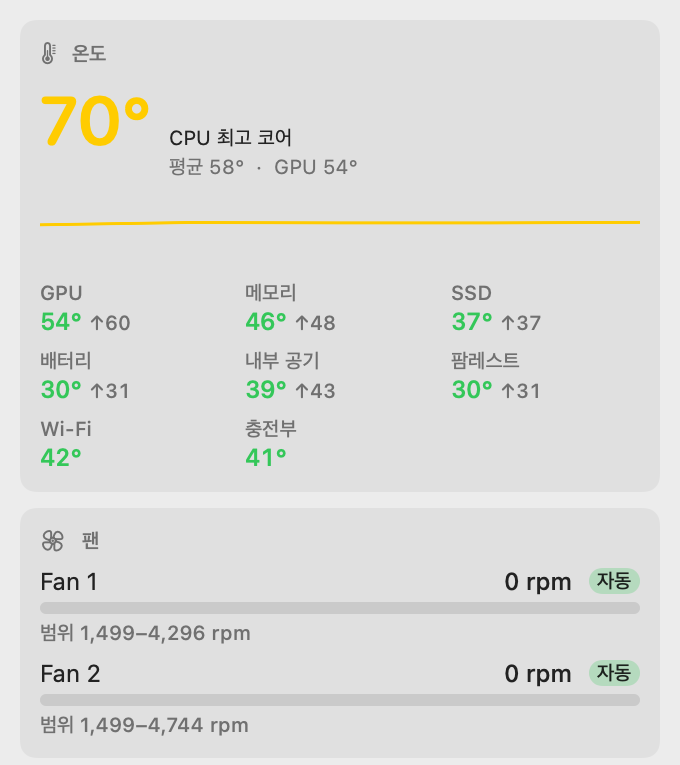
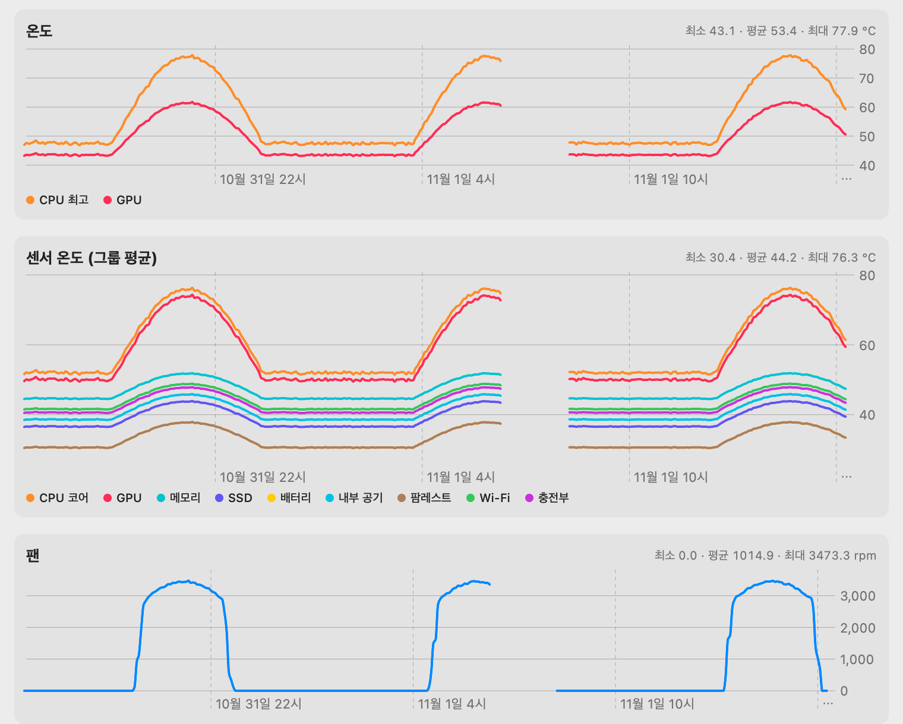

# MacPit

**English** · [한국어](README.ko.md)

[](https://github.com/mkhwang/macpit/actions/workflows/ci.yml)
[](https://github.com/mkhwang/macpit/releases/latest)
[](LICENSE)

A free, open-source menu bar app for Apple Silicon Macs that does three things in one place:

- **Temperatures** — CPU/GPU plus sensor groups (memory, SSD, battery, airflow, palm rest …), with 30-day history.
- **Fan control** — manual %, temperature profiles (quiet / balanced / performance), or **hold a target temperature** with a PI controller. Fans go back to macOS whenever MacPit is not sure.
- **Developer cache cleanup** — see and reclaim space from npm, pnpm, Gradle, Maven, JetBrains, Xcode DerivedData, Docker and more.

<p>
  
  
</p>

<sub>The history screenshot uses sample data. The app UI is currently Korean; English localization is planned.</sub>

## Install

Requires an Apple Silicon Mac and macOS 14 or later.

**Homebrew**
```bash
brew tap mkhwang/macpit https://github.com/mkhwang/macpit
brew trust mkhwang/macpit     # Homebrew 5+: allow casks from this tap
brew install --cask mkhwang/macpit/macpit
```

**DMG** — download `MacPit-<version>.dmg` from [Releases](https://github.com/mkhwang/macpit/releases/latest) and drag MacPit to Applications.
MacPit is free and is not notarized by Apple, so macOS blocks the first launch. Run once:
```bash
xattr -dr com.apple.quarantine /Applications/MacPit.app
```
or open **System Settings → Privacy & Security → Open Anyway**.

**Turn on fan control** — open the panel and click **팬 제어 설치…** (*Install fan control*). macOS asks for your admin password once. Monitoring, history and cleanup work without it.
The **설정** (*Settings*) menu has *Open at login* and *Remove fan helper*.

**Build from source** (Xcode or Command Line Tools, Swift 5.9+)
```bash
git clone https://github.com/mkhwang/macpit.git && cd macpit
./scripts/build.sh          # build/MacPit.app, build/macpitd, build/macpitctl
sudo ./scripts/install.sh   # fan helper + ~/Applications/MacPit.app + open at login
```

**Upgrading from MacMon 0.1.x** — the project was renamed from MacMon to MacPit in 0.2.0. Install MacPit, launch it once (history, settings and *Open at login* move over automatically, and the old app is quit), then click **팬 제어 설치…** to replace the old `macmond` helper. Delete `MacMon.app` afterwards. Homebrew users: `brew uninstall --cask macmon && brew untap mkhwang/macmon`, then install as above.

> ⚠️ Do not run MacPit together with another fan control app. They overwrite each other's settings.

## How it compares

| | MacPit | [Stats](https://github.com/exelban/stats) | Macs Fan Control | TG Pro |
|---|---|---|---|---|
| Open source | ✅ MIT | ✅ MIT | — | — |
| Price | Free | Free | Free / Pro | Paid |
| Menu bar sensors | ✅ grouped | ✅ | ✅ | ✅ |
| Fan control on Apple Silicon | ✅ manual · profile · target temp | legacy, marked unmaintained | ✅ | ✅ |
| Developer cache & Docker cleanup | ✅ | — | — | — |

Stats is the better general-purpose system monitor. MacPit is for developers who want fan control and cache cleanup without paying for two apps.

## Features

### Temperatures
- Menu bar shows any of CPU % · CPU temp · memory % · GPU temp · fan RPM · network (default `17% 67° M74% 3.2k`).
- Dozens of SMC sensors grouped into CPU cores, GPU, memory, SSD, battery, internal air, palm rest, Wi-Fi and charger, each with average and max.
- Only sensors that actually respond on your Mac are used. Missing groups are hidden.

### Fan control
| Mode | Behavior |
|---|---|
| System | macOS manages the fans (default) |
| Manual | Fixed 0–100% (0% = minimum RPM) |
| Profile | Temperature → fan % presets: quiet, balanced, performance. The panel draws the profile and where you are on it |
| Target temp | Keeps the hottest CPU core near a target with a PI loop, hands back to macOS once cool |

Safety:
- Above the safety temperature (default 95°C) fans go to 100% in every mode.
- Sensor read failure or helper shutdown (SIGTERM etc.) returns fans to macOS immediately.
- Output changes at most ±8% per second.
- On start, clears forced modes left by a previous crash.

Works with fanless (MacBook Air, monitoring only), single-fan (Mac mini) and dual-fan (MacBook Pro) Macs. Fan count is cross-checked by probing keys in case `FNum` is wrong.

### Developer cache and Docker cleanup
| Group | Targets |
|---|---|
| Node | npm · pnpm store · Yarn · Bun · node-gyp · Playwright/Puppeteer browsers |
| JVM | Gradle caches/wrapper/daemon · Maven `~/.m2` ⚠︎ · JetBrains caches and logs |
| Apple | Xcode DerivedData · iOS DeviceSupport · SwiftPM · CocoaPods |
| Other | pip · uv · Go build · Cargo · Homebrew · VS Code caches · Trash ⚠︎ |
| Docker | build cache · unused images ⚠︎ · stopped containers ⚠︎ · unused volumes ⚠︎ |

- Only **safe** items (re-downloadable caches) are checked by default. ⚠︎ items can lose data and are never pre-selected.
- One-click cleanup asks for confirmation. Optional weekly or monthly auto-cleanup runs safe items only.
- Hard-coded whitelist under your home folder, symlinks pointing outside home are refused, folders are emptied but kept.

### History and processes
- 10-second averages in a local SQLite file, kept 30 days: CPU, temperatures, sensor groups, fan RPM, memory, network, free disk, battery.
- 1h / 24h / 7d / 30d charts. Gaps where the app was not running are shown as breaks.
- Top 5 processes by CPU and memory, root processes included (collected only while the panel is open).

### CLI
```bash
macpitctl sensors              # temperatures, sensor groups, fans (no root needed)
macpitctl status               # helper status
macpitctl manual 60            # fans at 60%
macpitctl target 70            # hold CPU at 70°C
macpitctl profile balanced     # quiet | balanced | performance
macpitctl system               # give fans back to macOS
macpitctl storage              # cache and Docker usage
macpitctl clean safe           # preview only, deletes nothing
macpitctl clean npm gradle --yes
macpitctl history 24h          # 1h | 24h | 7d | 30d
macpitctl top                  # top processes
```

## Tested Macs

| Model | Chip | Fans | Result |
|---|---|---|---|
| `MacBookPro18,1` | M1 Pro | 2 | manual, profile, target temp and hand-back verified |

On other models fan control is **experimental** and the panel says so. SMC key layouts can change between chips.
Please [send a device report](https://github.com/mkhwang/macpit/issues/new?template=device-report.yml) with the output of `macpitctl sensors`. Each report adds a row here.

## How fan control works

Apple Silicon fans are controlled through SMC keys.

| Key | Type | Meaning |
|---|---|---|
| `FNum` | ui8 | number of fans |
| `F{n}Ac` / `F{n}Mn` / `F{n}Mx` | flt | current / min / max RPM |
| `F{n}Md` | ui8 | mode. Default (e.g. 3) = system, **1 = forced** |
| `F{n}Tg` | flt | target RPM |

1. On start, remember each fan's original `Md`.
2. While controlling, every second ensure `Md=1` and write `Tg` (macOS may reset the mode, so it is rewritten).
3. To hand back, restore the original `Md` and macOS takes over again.

Measured on a MacBook Pro M1 Pro (`MacBookPro18,1`): manual 60% took the fans from 0 to 3180 / 3440 rpm in about 6 seconds, and hand-back restored `Md=3`.

## Architecture

```
┌───────────────┐  JSON over Unix socket   ┌───────────────────────┐
│ MacPit.app    │ ───────────────────────▶ │ macpitd (root)        │
│ menu bar, UI  │  /var/run/macpitd.sock   │ 1 s loop: policy →    │
│ (your user)   │ ◀─────────────────────── │ SMC fan writes        │
└──────┬────────┘                          └──────────┬────────────┘
       │ SMC reads · cleanup · SQLite                 │
       ▼                                              ▼
   AppleSMC (IOKit)                             AppleSMC (IOKit)
```

| Path | Contents |
|---|---|
| `Sources/CSMC` | AppleSMC IOKit user client in C (80-byte `SMCParamStruct`) |
| `Sources/MacPitCore` | SMC wrapper, sensor and fan detection, fan policy (profiles, PI), IPC, stats, cleanup, history |
| `Sources/macpitd` | root LaunchDaemon, the only process that writes to the SMC |
| `Sources/MacPitApp` | SwiftUI `MenuBarExtra` app |
| `Sources/macpitctl` | CLI |
| `Sources/macpit-selftest` | policy, detection and history tests (run in CI) |
| `Casks/macpit.rb` | Homebrew cask (this repo is the tap) |

See [SECURITY.md](SECURITY.md) for what the root helper can and cannot do.

## Resource use

About 1–2% CPU with the panel closed and a memory footprint around 30 MB (M1 Pro). Hot sensors are read every 2 s, the rest every 10 s; disk usage is cached for 30 s; process lists are collected only while the panel is open.

## Development

```bash
swift build
swift run macpit-selftest        # tests (an executable target, so it runs without XCTest)
./scripts/package.sh             # build/dist/MacPit-<ver>.dmg, .zip, SHA256SUMS

# helper flow without root (SMC writes are rejected)
MACPIT_DRYRUN=1 MACPIT_SOCKET=/tmp/m.sock MACPIT_CONFIG=/tmp/c.json .build/debug/macpitd
MACPIT_FAKE_FANS=0 .build/debug/macpitctl sensors                  # pretend to be fanless
MACPIT_HOME=/tmp/fakehome .build/debug/macpitctl clean safe --yes  # cleanup in a fake home
```

Releases: bump `macpitVersion` in `Sources/MacPitCore/Version.swift`, push a `v<version>` tag. GitHub Actions builds the DMG, creates the release and updates the cask.

## Limitations

- Apple Silicon only. Intel Macs force fans differently and are not supported.
- History is recorded only while the app runs.
- Ad-hoc signed, not notarized.

## Disclaimer

MacPit writes to the SMC. It has safeguards, but pinning fans low raises temperatures, and you use it at your own risk. This is a personal project, not affiliated with Apple.

## License

[MIT](LICENSE)
